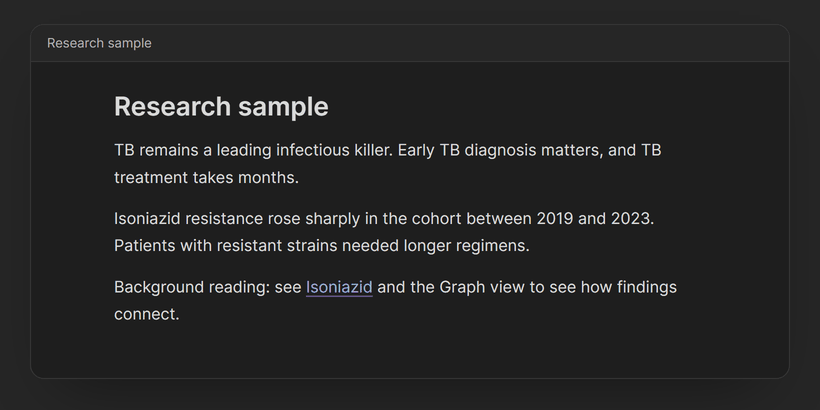
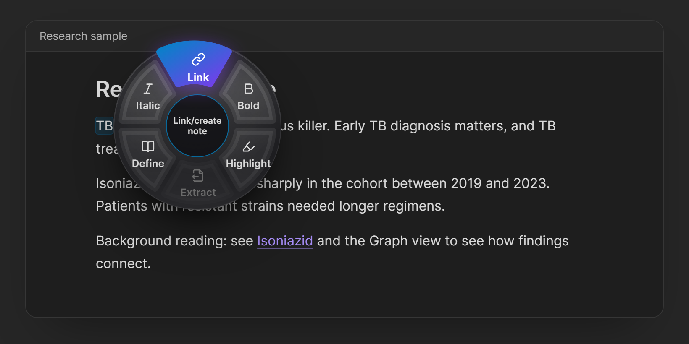
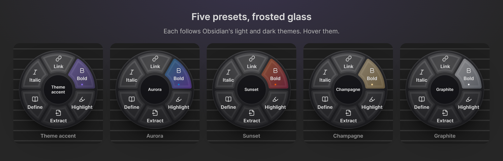
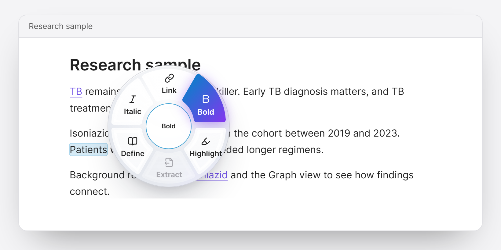

# Word Hover Actions

Hold **Shift** over a word in Obsidian to open an action wheel: link or create notes, format text, extract passages, and look up definitions, without leaving the line you're writing.



**[▶ Try the interactive demo](https://jokeroct.github.io/word-hover-actions/)**: the real wheel, running in your browser.

## Features

### The wheel

Hold Shift and hover a word, or rest the pointer on a word and press Shift. The wheel opens beside the word almost at once. You can let go of Shift and click a segment.



| Action | What it does |
| --- | --- |
| **Link** | Search your vault, or create a note with an editable title. The hovered text becomes a link and keeps its wording: `[[Mango smoothie\|Mango]]`. You stay in the note you're writing. |
| **Bold** / **Italic** / **Highlight** / **Strike** | Toggle `**text**`, `*text*`, `==text==`, `~~text~~`. Already-applied formatting is marked, and toggling removes it. |
| **Extract** | Moves a selected passage (several lines are fine) into a new note and leaves a link or an embed in its place. The new note links back with a `source` property. |
| **Define** | Shows the Wikipedia summary and Wiktionary definitions. **Create linked note** turns the summary into a note and links the word to it. |
| **Shorten** | Shortens the selection, or the whole paragraph under the pointer, to about a third, half, or two-thirds. The result opens in an editable preview, with **Replace**, **Insert below**, and **Copy**. Works offline: it keeps the key sentences in their own wording and trims filler. Optionally, a local AI (Ollama) can rewrite it instead. |
| **Custom wrappers** | Your own toggles, such as `%%comment%%`, `$math$`, or `<u>underline</u>`. |

The wheel holds 4, 6, or 8 actions (6 by default), and you choose which action goes in each slot. Shorten isn't in the default layouts; put it in a slot in Settings.

### Link tools

Hover an existing link and the wheel switches to link tools:
- **Peek**: preview the note and see how many notes link to it.
- **Unlink**: remove the link and keep its text.
- **Change**: point the link at a different note, keeping your wording.
- **Split**: open the linked note in a split pane.

### After linking

When you link a word, a small toast offers two shortcuts:
- **Add “TB” as alias**, so `TB` finds *Tuberculosis* directly next time.
- **Link 2 more mentions**, which links every other plain mention of the same word in the note in one undoable edit.

### Frosted glass, five presets



The wheel, the dialogs, and the toast share a frosted-glass look in light and dark themes. Choose **Theme accent** (follows your Obsidian accent color), **Aurora**, **Sunset**, **Champagne**, or **Graphite** in Settings. A live preview there shows your own slot layout.



## How it works

- **What an action applies to.** If you hover inside a selection, the whole selection; otherwise the word under the pointer. `well-known`, `don't`, and `snake_case` count as one word.
- **Selections over several lines** are formatted line by line, since Markdown formatting can't cross a line break: each line gets its own `**…**`, after any bullet, heading mark, or quote marker. Clicking again removes it from all of them. Link and Define need a single line.
- **Hovering never changes your note.** Only clicking a segment does, and every edit can be undone with Ctrl/Cmd+Z.
- **When an action is unavailable**, its segment is dimmed and the center of the wheel says why: inside code, math, properties, or a tag, or Link or Define on a selection that spans several lines.
- **The note picker:**
  - Matches names and aliases, and shows folder paths when two notes share a name.
  - Creates new notes in your *Default location for new notes*.
  - Never overwrites a file or silently creates a duplicate.
  - Uses your link settings (wikilinks or Markdown links, link paths).
- **If the note changes while a dialog is open** (sync, another pane, another plugin), nothing is inserted, and a notice tells you why.
- **Closing the wheel:** Escape, typing, scrolling, clicking elsewhere, or moving the pointer away.

## Settings

**Settings → Word Hover Actions**
- **Appearance:** color preset, with a live preview.
- **Wheel:** how quickly it opens (default 40 ms after the pointer settles on a word), 4, 6, or 8 segments, and the action for each slot.
- **Custom wrappers:** name, icon (any [Lucide](https://lucide.dev/icons) name), and the text to put before and after.
- **After linking:**
  - Offer to link other mentions.
  - Learn aliases: *Ask each time*, *Always*, or *Never*.
- **Extract to note:** replace the passage with a link or an embed.
- **Shorten:** how much to keep (default about half), and the method: *Built-in (offline)* or *Local AI (Ollama)*, with Ollama's address and model.
- **Look up:** the Wikipedia/Wiktionary language (default `en`). Shorten also uses it to split sentences; it trims wordy phrasing in English only.

## Network use

Word Hover Actions works offline, with two exceptions, which you trigger yourself:

- **Define** sends the word or phrase you clicked to **Wikipedia** (`<language>.wikipedia.org`) and **Wiktionary** (`en.wiktionary.org`), to show its summary and definitions.
- **Shorten**, only if you choose *Local AI (Ollama)* in Settings, sends the passage to your Ollama server: `http://localhost:11434` by default, a program on your own computer. With the built-in method (the default), nothing is sent.

Nothing is sent when you merely hover, and nothing else ever leaves your computer.

There is no telemetry, no account, and no tracking. Your settings stay in the plugin's own data file inside your vault.

## Installation

**From Obsidian:** open **Settings → Community plugins → Browse**, search for **Word Hover Actions**, then select **Install** and **Enable**. This works once the plugin is listed in the Community directory.

**Manually:**
1. Download `main.js`, `manifest.json`, and `styles.css` from the [latest release](https://github.com/jokeroct/word-hover-actions/releases/latest).
2. Put them in `<your vault>/.obsidian/plugins/word-hover-actions/`.
3. Reload Obsidian, then enable **Word Hover Actions** under **Settings → Community plugins**.

Requires Obsidian 1.14.4 or later, on desktop (it relies on a mouse and the Shift key).

## Known limitations

- Rendered tables, embeds, and math in Live Preview don't open the wheel, to avoid acting on the wrong text. In Source mode, or with the cursor inside them, they work.
- Callouts work while Live Preview shows them rendered, including PDF++ highlight callouts: the wheel finds the hovered word in the callout's markdown. Text that isn't in the markdown as-is (an escaped character, for example) doesn't open the wheel.
- Reading view isn't supported; the wheel works in the editor.
- Languages written without spaces (Chinese, Japanese) are treated as one long word. Select the phrase instead.

See [TESTING.md](TESTING.md) for what has been tested and what hasn't.

## Development

```bash
npm install
npm run dev          # rebuild main.js on every change
npm test             # unit tests (Vitest)
npm run build        # type-check, then production build
npm run build:demo   # build the interactive demo into docs/
npm run install-plugin -- "/path/to/test vault"   # copy the build into a vault
```

- `src/text/` holds the editor-independent logic, and is what the unit tests cover.
- `src/hover-extension.ts` is the CodeMirror extension that tracks Shift and the pointer.
- `src/menu.ts` draws the wheel.
- `demo/` runs that same wheel code and stylesheet in a web page.

**Releasing:**
1. Run `npm version patch` (or `minor` / `major`). This updates `manifest.json` and `versions.json`.
2. Push the commit and the new tag (`git push --follow-tags`). A GitHub Action builds the plugin and creates a draft release with `main.js`, `manifest.json`, and `styles.css`.
3. Review the draft and publish it.

## Credits

- Icons on the demo page are from [Lucide](https://lucide.dev) (ISC license); inside Obsidian, the plugin uses Obsidian's built-in copy of the same icons.
- Word Hover Actions is an independent project and isn't affiliated with Obsidian.

## License

[MIT](LICENSE) © 2026 MON.D.SAMA
